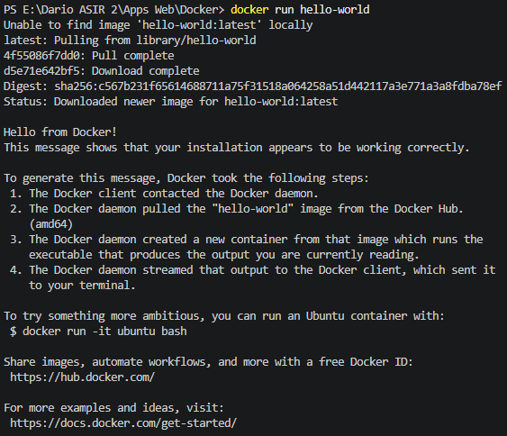
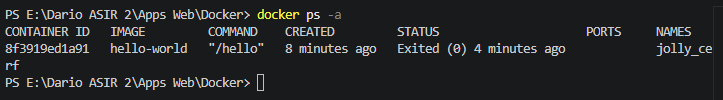
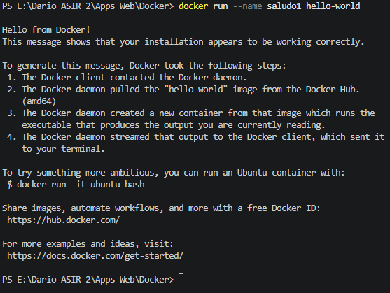
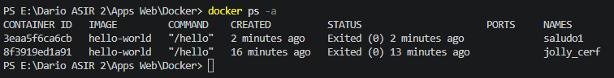
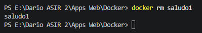
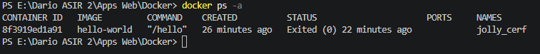
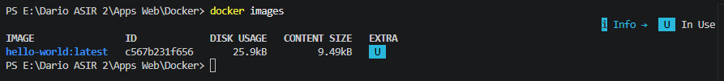
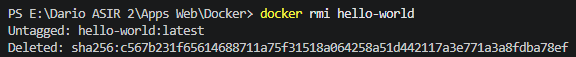
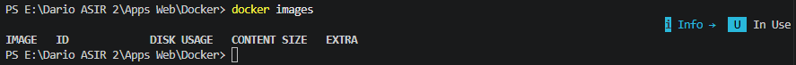

# Práctica Docker: Contenedores efímeros

**Alumno:** Dario Wallner Astiz
**Fecha:** 05/11/2026

---

## Introducción

Un contenedor efímero es aquel que realiza una tarea y se detiene inmediatamente al terminar. En esta práctica uso la imagen hello-world para entender el ciclo que tiene un contenedor Docker: descargar la imagen, ejecutar el contenedor, ver su estado, nombrarlo, eliminarlo y, por último, eliminar la imagen.

---

## Parte 1: Ejecutar el primer contenedor

### 1.1. Ejecución y descarga

**Explicación:** `docker run hello-world` crea y arranca un contenedor a partir de la imagen `hello-world`. Si la imagen no está en mi equipo, Docker la descarga automáticamente desde Docker Hub antes de ejecutarla.

`docker run hello-world`

**Captura de pantalla (1):** comando y resultado.

### 1.2. Reflexión y documentación

**¿Qué mensaje aparece? Acciones que Docker reporta:**
Docker indica que no encuentra la imagen en local (`Unable to find image 'hello-world:latest' locally`), la descarga del repositorio (Docker Hub), comprueba su integridad (verifica el digest/estado de la descarga), ejecuta el contenedor, que imprime el mensaje "Hello from Docker!" explicando los pasos que ha seguido, y el contenedor sale (termina) al acabar su tarea.

**¿Dónde reside la imagen ahora? ¿Se ha eliminado?**
La imagen queda almacenada en el almacén local de imágenes de Docker de mi equipo. No se ha eliminado tras la ejecución: se conserva para poder reutilizarla en futuras ejecuciones sin volver a descargarla.

**¿Sigue "vivo" o terminó? ¿Estado final?**
El contenedor terminó. Su única tarea era imprimir el mensaje, así que al acabar se para. Su estado final es **Exited (0)**, es decir, finalizó correctamente sin errores.

### 1.3. Verificación del contenedor detenido

**Explicación:** `docker ps` solo muestra los contenedores en ejecución. Como `hello-world` ya terminó, no aparecería. Con el argumento `-a` se listan todos los contenedores, también los detenidos.

`docker ps -a`

**Captura de pantalla (2):** resultado del comando.

- **CONTAINER ID:** `8f3919ed1a91`
- **STATUS:** `Exited (0) 4 minutes ago`
- **NAMES (aleatorio):** `jolly_cerf`

---

## Parte 2: Nombrar contenedores para una mejor gestión

### 2.1. Ejecutar con nombre personalizado

**Explicación:** el flag `--name` permite asignar un nombre propio al contenedor en lugar del nombre aleatorio que genera Docker. Aquí lo llamo `saludo1`.

`docker run --name saludo1 hello-world`

**Captura de pantalla (3):** comando y resultado.

### 2.2. Verificación y reflexión

**Explicación:** vuelvo a listar todos los contenedores para comprobar que `saludo1` aparece en la lista.

`docker ps -a`

**Captura de pantalla (4):** resultado con el contenedor `saludo1`.

### 2.3. Reflexión y documentación

**¿Qué diferencias noto en la columna NAMES?**
El primer contenedor tiene un nombre aleatorio generado por Docker, mientras que el segundo se llama `saludo1`, el nombre que yo he elegido.

**¿Por qué es útil asignar un nombre?**
Un nombre descriptivo es más fácil de recordar y de escribir que un ID hexadecimal o un nombre aleatorio. Permite identificar rápidamente para qué sirve cada contenedor y gestionarlo sin errores ni tener que buscar su ID cada vez. Además, es recomendable en entornos con muchos contenedores para que uno se acabe liando.

---

## Parte 3: Limpieza de contenedores detenidos

### 3.1. Eliminación por nombre

`docker rm saludo1`

**Captura de pantalla (5):** comando y resultado.

### 3.2. Verificación de la eliminación

**Explicación:** listo de nuevo todos los contenedores para confirmar que `saludo1` ya no existe.

`docker ps -a`

**Captura de pantalla (6):** resultado que muestra la ausencia del contenedor `saludo1`.

> el primer contenedor (nombre aleatorio) seguirá apareciendo, ya que solo se pidió eliminar `saludo1`.

---

## Parte 4: Limpieza de imágenes

### 4.1. Listar imágenes locales

**Explicación:** `docker images` muestra las imágenes descargadas en mi equipo. Aunque haya borrado el contenedor, la imagen `hello-world` sigue presente.

`docker images`

**Captura de pantalla (7):** resultado que muestra la imagen `hello-world`.

### 4.2. Eliminación de la imagen

**Explicación:** `docker rmi` elimina una imagen local por su nombre.

`docker rmi hello-world`

**Captura de pantalla (8):** comando y resultado.

### 4.3. Verificación final

**Explicación:** compruebo que la imagen ya no aparece en el sistema.

`docker images`

**Captura de pantalla (9):** resultado final que muestra la ausencia de la imagen.

### 4.4. Reflexión y documentación

**¿Cuál es la diferencia fundamental entre `docker rm` y `docker rmi`? ¿Qué elimina cada uno?**
- `docker rm` elimina contenedores (instancias de ejecución, que deben estar detenidos).
- `docker rmi` elimina imágenes (las plantillas a partir de las cuales se crean los contenedores).

Se puede borrar un contenedor y conservar la imagen, pero no se puede borrar una imagen mientras exista algún contenedor creado a partir de ella.

**¿Qué ocurriría si ahora ejecutara `docker run hello-world` de nuevo?**
Como la imagen ya no está en local, Docker volvería a descargarla desde Docker Hub (`Unable to find image 'hello-world:latest' locally`), y después crearía y ejecutaría un nuevo contenedor, mostrando de nuevo el mensaje de bienvenida.

## Conclusión

He comprobado que un contenedor efímero ejecuta su tarea y se detiene, pero sus restos (contenedor e imagen) permanecen en el sistema hasta que se eliminan manualmente. Gestionar bien los nombres y limpiar contenedores e imágenes que ya no se usan mantiene el entorno ordenado y libera espacio.